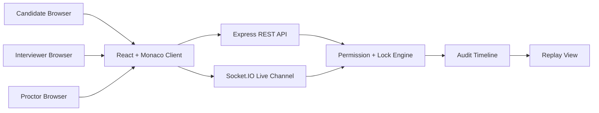

# Architecture Notes

## System Overview

CSE uses a three-part architecture:

1. React frontend for the collaborative coding workspace.
2. Node.js backend for API, live session events, and permission enforcement.
3. Optional PostgreSQL and Redis services for persistence and pub/sub scaling.

## Permission Model

Roles:

- Candidate: can view visible files and edit unlocked files.
- Interviewer: can manage file access and edit unlocked files.
- Proctor: can view files and manage access, but does not edit code in the prototype.

File controls:

- `visibility`: `visible` or `hidden`
- `locked`: `true` or `false`

## Replay Timeline

The audit timeline stores:

- File changes
- Reveal and hide events
- Lock and unlock events
- Rejected edit attempts

This allows reviewers to answer questions such as: "Was the hint visible before this code was written?"

## Prototype Storage

The current mini project stores sessions in memory so the project is easy to run for demonstration. The included Docker Compose file prepares PostgreSQL and Redis for a later production-grade implementation.
